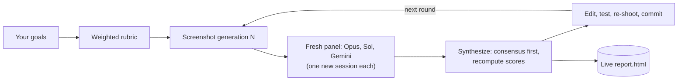

# Design panel review: how it works

`SKILL.md` holds the agent's instructions. This page explains the method for people: what
happens, why it's set up this way, and how to read the report.

## The idea

You have a working UI and goals for it ("make it easy to see everything in flight", "rich and
interactive"). The agent improves the design one generation at a time. It asks a panel of AI
judges to grade each generation against a rubric and acts on what they agree on. This is a
hill climb: each round should score higher than the last, and the scores show whether it does.



## The steps

1. **Rubric.** The agent turns your goals into 8–10 criteria scored 1–10, with weights that
   add up to 100. Criteria that come straight from your goals get the most weight. Each
   criterion has an observable test and anchors for what 3, 6 and 9 look like. Judges must
   return the same thing every time: a score table, a weighted overall, their top 5
   improvements, a "keep, don't regress" list, and any bugs they can see.
2. **Brief.** One page of product context, constraints and a walk-through of the screen, so
   judges understand interactions a screenshot can't show. Only its last section, "Changed in
   this generation", is rewritten each round.
3. **Screenshots.** Headless Edge or Chrome captures the UI against fixed demo data at the same
   sizes every round (by default a desktop fold, a full page, and a narrow 820 px view). The
   agent looks at the shots itself first and fixes obvious defects before the judges see them.
4. **Panel.** Every round, the agent starts one new read-only reviewer per model family, all in
   parallel. Round 0 is your current design, unchanged.
5. **Synthesis.** The agent recomputes each weighted score itself and gives priority to what two
   or more judges raised. Factual inconsistencies come first, such as a chart whose numbers
   disagree with the board. Items on any judge's "keep" list are protected.
6. **Edit.** The agent implements those changes, runs the tests, checks the live page for
   errors, re-shoots and commits (`round-N redesign (...)`), then the next round begins.
   The default is three rounds of edits after the baseline.

## Why it's set up this way

- **Several model families.** Judges have different biases. In the first run, Gemini scored
  highest every round, while Opus and Sol were harsher and gave more concrete criticism.
  Averaging across families keeps one generous or harsh judge from steering the climb.
- **A fresh judge every round.** A judge that remembers its last score anchors on it and
  grades the change rather than the design. A new session scores each generation on its own
  merits.
- **Read-only judges.** Reviewers only look and report. All edits go through one agent, so
  changes stay coherent and are committed one round at a time.
- **Recomputed scores.** Models sometimes get weighted arithmetic wrong. The report builder
  recomputes every overall score from the criterion scores and warns when a judge's own number
  doesn't match.
- **Fixed demo data and viewports.** Score changes then come from the design, not from
  different data or window sizes.

## Reading the report

`report.html` is a single file with the screenshots embedded, so it opens offline. It reloads
itself every 30 seconds while the climb runs. The agent tells you its path; open that file,
not a copy, because copies don't update.


- **Top row:** how many generations there are, the baseline and latest panel averages, the
  gain, and the best round.
- **Overall score by judge:** one line per judge plus a dashed panel average. Lines that
  converge mean the judges agree.
- **Panel mean per criterion:** a heatmap of criteria by round, with the change from first to
  last. It shows which goals improved and which lag behind.
- **Generations:** one row per round with the commit, thumbnails (click to enlarge), each
  judge's score, the average with ▲/▼ against the previous round, what changed, and the
  feedback that drives the next round. A round still being reviewed shows as *pending*.
- **Criterion scores by judge:** every judge's raw scores, so you can see where they disagree.

To share the report, build a copy without the auto-reload and export it as a PDF (OneDrive and
SharePoint download HTML instead of displaying it):

```powershell
node scripts\build-report.mjs <review-dir> --share
msedge --headless=new --disable-gpu --no-pdf-header-footer --print-to-pdf="<review-dir>\report.pdf" "<review-dir>\report-share.html"
```

## Example result

The first run used this method on a GitHub-native "software factory" dashboard. It had ten
criteria, weighted 15/15/15/10/10/10/10/5/5/5, with three judges and three viewports.

| Round | Opus | Sol | Gemini | Panel avg |
| --- | --- | --- | --- | --- |
| 0 (baseline) | 5.2 | 5.5 | 5.6 | 5.43 |
| 1 | 7.3 | 7.0 | 8.3 | 7.52 |
| 2 | 7.3 | 7.0 | 8.7 | 7.67 |
| 3 | 7.8 | 8.0 | 8.7 | 8.17 |

The biggest jump came in round 1: a "flight deck" showing what is running now and a flow
chart. Later rounds had smaller gains, mostly from fixing inconsistencies the judges flagged
(the flow chart didn't match the board's counts) and adding filters.

## Asking for it

> Use the design-panel-review skill. Do three rounds of panel reviews on this dashboard; round 0
> is the current design. Goals: see everything in flight, show what's moving through the
> system, rich and interactive, familiar engineering idioms.

You can change the number of rounds, the judges' models, the viewports, or the goals. The
agent shows you the rubric's criteria and weights before round 0.

## Requirements

Node 18+ for `scripts/build-report.mjs`, and PowerShell with Edge or Chrome for
`scripts/shoot.ps1`. The agent needs sub-agents that can run different models.
