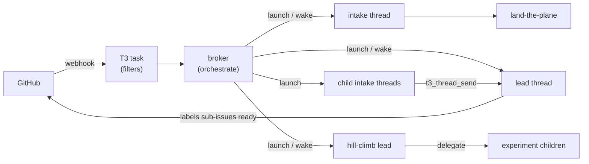
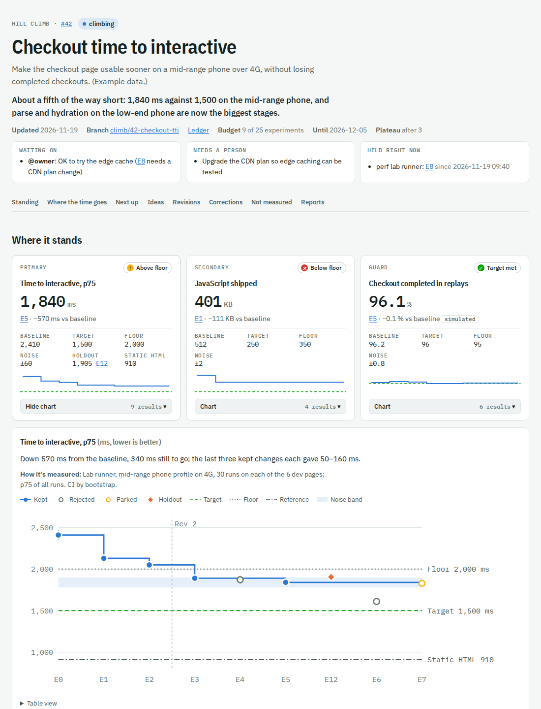

# gh-orchestrator

Hand GitHub issues to the agent in [T3 Code](https://t3.codes). Label an issue
`ready` or assign it to the agent account, and a broker thread starts a
worktree thread for it:

- **A small issue** gets an intake thread. It reviews the issue, asks blocking
  questions on the issue or builds it with `land-the-plane`, and answers later
  comments.
- **A large feature** (labelled `initiative`) gets a lead thread. With you on
  the issue, it agrees success criteria and plans sub-issues across repos. It
  then runs each sub-issue in its own child thread, reviews the children's PRs
  against the plan, and keeps the plan current.
- **A number to move** (labelled `hill-climb-lead`) gets a hill-climb lead.
  With you on the issue, it agrees what to measure, with targets, floors and
  noise bands, and takes an honest baseline. It then runs experiments in child
  agents, keeps or rejects each with the number that decided it, and reports
  through the issue and a dashboard.

```
/plugin marketplace add andrejpk/andrej-agent-kit
/plugin install pr-flow@andrej-agent-kit
/plugin install gh-orchestrator@andrej-agent-kit
```

Then, in a new T3 Code thread in the repo's project, signed in to `gh` as the
agent account:

```
/gh-orchestrator:setup owner/repo
```

It needs T3 Code (scheduled tasks and thread tools), `gh`, and the `pr-flow`
plugin (in this marketplace) for `land-the-plane` and `settle-pr`. Two more
plugins, not included here, are used when installed and skipped otherwise:
`self-review`, which reviews the branch before the PR opens, and `provenance`,
which ends every comment the agent posts with whose session wrote it.

## How it works



- **Webhook tasks.** Four T3 webhook tasks, each behind its own GitHub hook,
  start a broker run only for:
  - `ready`, the lead label or the climb label added to an open issue, by a
    person or by a lead starting a child;
  - the agent assigned;
  - a person (not the agent, not a bot) commenting on an issue assigned to
    the agent;
  - an issue assigned to the agent being closed.

  Other labels, PR comments, and the agent's own comments, assignments and
  closes never start a run.
  A comment on a tracked issue that isn't assigned to the agent waits for the
  sweep.
- **Daily sweep.** A fifth task sweeps the repo once a day, for anything a
  missed delivery left behind.
- **Broker** (`orchestrate`, 🚦). All five tasks are bound to one broker thread,
  so their runs queue one at a time. Each run starts a fresh session, since
  all state is on GitHub. It runs `bin/gh-work.mjs`, acts on the answer, and
  ends with one line.
- **Intake thread** (`issue-intake`). One worktree thread per issue, off the
  default branch, titled `🎫 #<n> <title>` (`🧩` for a sub-issue of a
  lead). It lasts as long as the issue: each wake continues the same
  conversation, and you can work in the thread directly too. If its analysis finds several PRs,
  several repos or a design to settle first, it proposes leading the issue as
  an initiative and waits. When a person agrees (by replying, or by adding
  the label), the same thread switches to `lead-initiative` and its 🎫 becomes 🧭.
  If the goal is a number to move and the way there is uncertain, it proposes
  a hill climb instead, and switches to `lead-hill-climb` (🧪) the same way.
- **Lead thread** (`lead-initiative`, 🧭). Phases: understand, plan (approved
  before anything is created), create sub-issues with native sub-issue and
  blocked-by links, delegate, land, adjust. The lead starts a child by
  labelling a sub-issue `ready`, a few at a time, and that repo's broker
  starts it like any other issue, in that repo's project. A person reviews and merges every
  PR. Each PR goes into the default branch unless a feature branch is asked
  for.
- **Links.** The issue is assigned to the agent and carries a marker comment
  (`<!-- t3-thread: <threadId> -->`, newest wins) with a link to the thread
  (`https://app.t3.codes/<environment>/<thread>`, which opens for whoever can
  reach that T3 environment). An initiative's or climb's parent issue body is
  its status page: status and steps at the top (between `<!-- lead-status -->`
  markers), the rest collapsed. Its settings and success criteria are a pinned
  comment (`<!-- lead-plan -->`).

### Lead and children talk directly

A child thread sends to its lead with `t3_thread_send` when it posts
blocking questions, hits a blocker, opens a draft PR or gets a PR ready. The
lead's thread id is on GitHub (the parent issue's marker), so the child can
always find it. A child knows exactly when these happen and what to
say. The orchestrator only sees webhooks: routing through it would need a
GitHub artifact for each message and a broker run to forward it. T3 queues a
send while the lead is busy.

The orchestrator forwards one thing children can't see: a sub-issue closing
when its PR merges, which wakes the lead to update the plan.

Lead and children also talk both ways in their threads, and the skills say
which channel to use. Anything a person reviewing the work later would want
to read goes on GitHub, with a one-line pointer in the thread:

- review feedback, on the PR;
- decisions, in the PR description or the plan;
- questions for a person, on the issue.

Status, nudges and quick factual answers stay between the threads. The lead
never comments on a sub-issue, and a child never comments on the parent. An
agent comment counts as the agent's reply, so it would hide a person's
unanswered comment from the wake check.

Starting children goes the other way, through GitHub: the lead labels a
sub-issue `ready`, the same control a person uses on any issue. One code path
starts every thread, the lead controls how many children run by how many it
labels, and a person can start a sub-issue early or hold one back by adding or
removing the label. The broker reads the child's base branch from the plan
comment's **Base** line.

### The lead label

GitHub's native issue types would fit, but many organisations have only Task,
Bug and Feature, and Feature covers every feature request. So it's a label,
`initiative`: a large piece of work led to completion, wider than one feature
and not tied to "epic". The label lives in one place, the task prompts
(`<lead-label>` in [`tasks.json`](skills/setup/tasks.json)), and the script
takes it as `--lead`. An issue type of the same name works the same way.

The label only chooses the skill; it doesn't hand the issue over. Assigning
the agent or adding `ready` does, as for any issue. The label on its own
starts a run only on an issue a thread already tracks, where it means "yes,
lead this".

A hill climb has its own label, `hill-climb-lead` (`<climb-label>`, the
script's `--climb`). It names how the work is run, not what is climbed:
a lead that climbs a number through experiments. A climb on its own, inside
one task, needs no label.

### Hill climbs

A hill climb is for a goal measured by numbers, where nobody knows which
changes will get there: latency, accuracy, cost, a score. The lead
(`lead-hill-climb`, 🧪) works like this:

1. It agrees each metric with you: how it's measured, a target, a floor and a
   noise band. It also agrees guard metrics that must hold, fixed dev and
   holdout splits, and stopping rules. A reviewer on a different model checks
   the plan first.
2. It measures a baseline (E0), with a chance or naive reference so a score
   means something.
3. It climbs:
   - each experiment runs in a child agent on its own branch off the climb
     branch, and writes its log as it goes;
   - a different model reviews it;
   - the lead keeps it, rejects it or parks it, with the number that decided
     it;
   - a kept experiment merges as `Merge E7: <outcome>`.

Targets change only through a numbered revision you agree to.

Experiments aren't sub-issues: the lead starts them with `delegate_task`.
That's the one exception to "children start through GitHub labels", and it
has reasons:

- a climb runs dozens of mostly rejected experiments, and an issue each would
  bury the real ones;
- nobody comments on an experiment;
- you steer through the plan (budget, how many at once, the ranked backlog)
  rather than by starting runs one at a time.

Children push their branches, so every idea, kept or not, can be opened on
GitHub. Work that should ship on its own (outside the climb, a feature in its
own right, another repo) is promoted to a sub-issue and starts like any child.

Numbers live in one place: a ledger in the repo, on the climb branch
(`climb.json` and one `ledger/E<n>.json` per experiment).
`bin/climb-report.mjs` builds everything people read from it:

- the issue's status section;
- `LOG.md`;
- a dashboard page with:
  - a one-line verdict, then the scoreboard (now vs baseline vs target);
  - a chart per metric over every experiment, with a one-line finding;
  - a breakdown of the problem: a waterfall when the stages add up, with
    each stage's baseline behind it; its parts filter the ideas;
  - the ranked backlog;
  - every idea tried, filterable, with its numbers and links to its branch,
    commits and PR;
  - revisions to the criteria, corrections to reported figures, and what
    isn't measured yet;
  - numbered reports that decisions cite as R1, R2.

  Each number says whether it was measured, derived, simulated or assumed.
  Bars and badges show which.

The lead republishes the dashboard to the same private Artifact URL after
each decision. [`skills/lead-hill-climb/example`](skills/lead-hill-climb/example)
is a complete made-up climb.




## Skills

| Skill | Who runs it | How often |
| --- | --- | --- |
| `orchestrate` | the broker | every webhook delivery that passes the filters, and the sweep |
| `issue-intake` | each issue thread, and each child of a lead | once per issue, then once per new comment or lead message |
| `lead-initiative` | a lead thread | for weeks; each wake reads the plan and what changed |
| `lead-hill-climb` | a hill-climb lead | until the targets are met, a plateau or the budget; each wake reads the plan, the ledger and what changed |
| `setup` | a person | once per repo; again to migrate or tear down |

They're separate so the broker loads only the short mechanical part on every
run, and none of the research, leading or setup text.

## Script

`bin/gh-work.mjs` does the GitHub reads and writes, and prints one line of
JSON:

- `check --repo O/R --issue N`: `start`, `wake` (with the thread and who
  commented), `none` or `skip` (with the reason). It also gives the `kind`
  (`issue` or `lead`) and, for a sub-issue, the parent and its lead thread.
- `sweep --repo O/R`: every issue to start or wake, and tracked candidates
  whose thread the broker should check still exists.
- `marker --issue N --thread ID [--kind K --model JSON]`: the marker comment,
  with the kind and model in a hidden `<!-- t3-meta: … -->` line.
- `plan --repo O/R --issue N`: an initiative's plan comment, whether its
  body has a status section and who else last edited it, new commenters,
  and each sub-issue's state, child thread, open blockers, PRs, and whether
  it's queued or can start.

`check`, `sweep` and `dashboard` take `--lead L` and `--climb C` for the two
labels (defaults `initiative` and `hill-climb-lead`); `kind` is `issue`,
`lead` or `climb`.
- `plan-comment --repo O/R --issue N --body-file F`: creates and pins the
  plan comment, or edits it in place.
- `body --repo O/R --issue N --body-file F [--whole]`: replaces only the
  body's status section, or with `--whole` the whole body, after saving the
  current body to `~/.cache/gh-orchestrator/issue-bodies/`.
- `sub-issue --parent URL --child URL` and `blocked-by --issue URL --by URL`:
  the native links.
- `dashboard --repo O/R [--dry-run]`: rewrites the dashboard issue, and posts
  the weekly summary when one is due. With `--refresh [--issue N]` it only
  rewrites an existing dashboard, reading issue N directly.

The agent account is whoever `gh` is signed in as. An issue is a candidate
when all of these hold:

- it's open;
- it's labelled `ready` or assigned to the agent;
- it isn't assigned to anyone else;
- no open PR closes it.

A tracked issue wakes when any of these happens:

- a person comments after the agent's last comment;
- `ready` is added back after the agent removed it;
- the lead or climb label is added after the agent's last comment.

`bin/climb-report.mjs` is the hill climb's ledger:

- `check --dir D`: problems in `climb.json` and `ledger/*.json`, such as a
  result without its `n` or a decision without its number.
- `build --dir D`: writes `LOG.md`, `build/status.md` (for `gh-work.mjs
  body`) and `build/index.html` (the dashboard). It prints the headline and
  the report files to publish beside the page.

Tests: `node --test plugins/gh-orchestrator/bin/*.test.mjs`.

## Dashboard

The broker rewrites a pinned **🤖 Agent work** issue from GitHub, with no
model involved: after each run that starts, wakes or tells a lead, after an
agent issue closes, and in the daily sweep. A PR change alone (opened,
reviewed, checks) shows at the next of these. Each open agent issue is a
task-list line with a live link (state and details on hover), its title and
what it's waiting on:

- ⏳ **waiting on people**: questions asked, PRs ready for review;
- 🧭 **initiatives**: phase and sub-issues done;
- 🧪 **hill climbs**: phase and the headline (the primary metric now vs its
  target);
- 🚧 **in progress**, and 📥 **queued** (labelled `ready`, not started);
- ✅ **closed in the last 7 days**, then the week's numbers.

Once a week the sweep also comments the week's numbers on the issue, so past
weeks stay readable. Edits to the body are replaced; comment instead.
`node bin/gh-work.mjs dashboard --repo O/R --dry-run` prints it without
writing.

## Data for reports

Everything a report needs stays on GitHub:

- the `agent` label, added when a thread starts and never removed, finds
  every issue the agent took;
- the marker comment's hidden `t3-meta` line records the kind (`issue` or
  `lead`) and the model settings, and the comment's date is the start;
- the issue timeline has the rest: when `ready` was added, whether `question`
  was, the agent's PRs (`Closes #n`), reviews and merges.

## Models

| Role | Default | Why |
| --- | --- | --- |
| Broker | Opus 5.5, low effort | the script decides; the broker follows a short table |
| Intake and child threads | Opus 5.5, medium | research, then `land-the-plane` |
| Lead threads | Opus 5.5, high | plans across repos, reviews each PR against the whole initiative; leads hill climbs |

`setup` puts the thread settings in the task prompts, and each launch passes
them explicitly so a thread doesn't inherit its launcher's effort.
